# ⚡ Awesome Autonomous AI QA Testing Agents 🤖

> A curated, SEO-optimized directory of autonomous AI agents, multi-agent QE fleets, self-healing test automation frameworks, synthetic data generators, and LLM-as-a-judge evaluation pipelines.

  
  
  
  
  
  

---

### 📑 Quick Navigation
[📈 Sector Overview & Market Dynamics](#-sector-overview--market-dynamics) •
[🏢 Enterprise SaaS QA Platforms](#-enterprise-autonomous-ai-qa-saas-platforms) •
[💻 Open-Source AI QA Agents](#-open-source-ai-qa-agents--testing-frameworks) •
[🔄 Adjacent Tools](#-notable-adjacent-tools-reframed) •
[⭐ Star History](#-star-history) •
[💖 Support & Sponsorship](#-support--community) •
[🤝 Contributing](#-contributing)

---

## 📈 Sector Overview & Market Dynamics

The dedicated AI-powered software testing and Quality Assurance (QA) sector is valued at approximately **$9.3B to $12.5B (2025–2026)**, expanding at a CAGR exceeding 25–30% toward an estimated $39B+ by the early 2030s.

The sector is **moderately to highly fragmented** rather than winner-take-all:
* **Enterprise Continuous Testing Suites**: Incumbents like **Tricentis**, **SmartBear**, and **Perforce (Applitools)** maintain deep enterprise governance, compliance, and multi-cloud test management integrations.
* **Cloud Browser Grids & Execution Infrastructure**: Platforms like **BrowserStack** and **Sauce Labs** dominate scalable cross-browser and real-device device execution grids, augmenting their execution fabrics with AI failure diagnosis and smart locators.
* **AI-Native Outcome & Agentic Platforms**: Emerging players like **QA Wolf**, **Functionize**, **mabl**, and **Virtuoso QA** deliver outcome-oriented autonomous test generation, natural-language authoring, and automated DOM self-healing.
* **Open-Source Standard Runners**: The market fundamentally builds upon ubiquitous open-source execution engines (**Playwright**, **Cypress**, **Selenium**, and **Puppeteer**), layered with intelligent Model Context Protocol (MCP) servers and vision-language agents.

---

## 🏢 Enterprise Autonomous AI QA SaaS Platforms

A comprehensive breakdown of enterprise-grade commercial platforms offering autonomous AI testing, visual AI validation, and self-healing test automation. Entries are sorted in descending order by company size and estimated market valuation.

| Platform | Company Size (Valuation / Scale) | Starting Tier Pricing | Free Tier / Trial Limits | Key Capabilities & Focus |
|:---|:---|:---|:---|:---|
| **[Tricentis Testim](https://www.testim.io/)** | **~$4.5B** valuation (Parent Tricentis; ~$500M ARR; acquired Testim for ~$150M–$200M) | **$450/month** (Starter tier for up to 3 parallel slots, custom enterprise quote-based thereafter) | **7-day free trial**; no permanent free tier; includes full access to AI-powered locators and authoring evaluation | 🧠 AI-powered low-code test automation, self-healing smart locators, Salesforce/web apps, enterprise CI/CD integration |
| **[BrowserStack](https://www.browserstack.com/)** | **~$4.0B** valuation ($225M–$230M+ ARR, bootstrapped & Series B) | **$39/month** (App Live / Live starting tier billed annually; Automate starts at $99/parallel slot/mo) | **Free trial**: 30 min interactive manual testing + 100 min automated testing on real devices; **Free forever tier**: Percy visual testing (5,000 screenshots/mo) | 📱 Cloud device & browser grid, Test Companion AI agents, automated failure analysis, Percy visual AI testing |
| **[mabl](https://www.mabl.com/)** | **~$360M** valuation (Series C; ~$18M ARR) | **~$450/month** ($5,400/year base entry tier for 500 monthly cloud credits; quote-based scaling) | **14-day free trial**; no permanent free tier; unlimited free local test authoring and runs; cloud execution metered | ⚡ GenAI-powered low-code E2E testing, auto-healing assertions, performance regressions, accessibility testing |
| **[Applitools](https://www.applitools.com/)** | **~$250M–$300M** valuation (Acquired by Thoma Bravo; ~$25M–$30M ARR) | **$667/month** ($8,004/year Starter tier for 1,000 page checkpoints or 100K component checkpoints/mo) | **14-day free trial**; no permanent free tier; unlimited users and test execution during evaluation | 👁️ Visual AI engine, Applitools Autonomous NLP-based test generation, Ultrafast Grid, cross-device visual diffing |
| **[QA Wolf](https://www.qawolf.com/)** | **~$170M** valuation (Series B; ~$15M–$20M ARR) | **Pay-As-You-Go** starting at **1¢/AI credit** + **15¢/runner minute** (Self-serve platform) or managed service contracts | **Free trial**: Initial package of free test runs included upon signup; no permanent free tier; custom monthly spend caps supported | 🐺 Autonomous multi-agent E2E test generation, 80% automated coverage guarantee, 100% parallel runs, zero test flakiness triage |
| **[Functionize](https://www.functionize.com/)** | **~$100M+** estimated valuation ($67M total funding; ~$17M–$19M ARR) | **$20/month** (Growth plan; 3,200,000 execution credits/mo); Scale plan at $100/mo (20M credits/mo) | **Free forever plan**: $0/mo with **800,000 credits/month** (+ 2,000,000 one-time onboarding bonus); all core agents included | 🏗️ Autonomous Architect agents, natural language test creation, self-healing SmartFix, big data visual & performance analysis |
| **[Katalon Studio AI](https://www.katalon.com/)** | **~$80M–$150M** estimated valuation ($30M funding; ~$36M–$62M ARR) | **$84/seat/month** ($1,000/seat/year for first 3 seats Studio Professional; Platform True bundles from $59/seat/mo) | **Free forever tier**: Katalon Studio Free (unlimited local authoring & execution; no CI/CD or headless runtime); **30-day free trial** for Pro | 🧪 Enterprise test authoring, AI-assisted test generation, StudioAssist failure analysis, cross-platform web/mobile/API/desktop |
| **[Virtuoso QA](https://www.virtuoso.qa/)** | **~$45M–$60M** estimated valuation (£18M / $23M total equity & debt) | **$4,500/month** (~$54,000/year starting enterprise capacity tier via custom/partner contracts) | **14-day trial / pilot** available on request following demo; no permanent free tier; enterprise journey volume limits apply | 🎯 Natural Language Programming (NLP) autonomous test authoring, Touchstone agentic validation, self-healing live DOM |

---

## 💻 Open-Source AI QA Agents & Testing Frameworks

Curated open-source repositories powering autonomous testing, browser interaction agents, LLM evaluation, and self-healing test automation. Entries are sorted descending by GitHub stargazers count, with real-time social badges linking directly to each repository's stargazers page.

| Project & Repo | GitHub_Stars | License | Capabilities & Focus | Ecosystem |
|:---|:---|:---|:---|:---|
| **[microsoft/playwright-mcp](https://github.com/microsoft/playwright-mcp)** |  | MIT | Official Model Context Protocol (MCP) server for Playwright, empowering AI coding agents (Claude Code, GitHub Copilot) to navigate websites, inspect accessibility trees, and autonomously generate and verify Playwright scripts. | Node.js / Playwright / MCP |
| **[promptfoo/promptfoo](https://github.com/promptfoo/promptfoo)** |  | MIT | CLI-first automated testing, LLM application evaluation, red-teaming, and security fuzzing framework for GenAI applications with CI/CD quality gating and assertion matrices. | TypeScript / CLI / Multi-LLM |
| **[browserbase/stagehand](https://github.com/browserbase/stagehand)** |  | MIT | AI-first web browsing and automation SDK built on Playwright. Uses natural-language primitives (`act`, `extract`, `observe`) that adapt dynamically to DOM structural changes without broken selectors. | TypeScript / Playwright / AI Browsing |
| **[Skyvern-AI/skyvern](https://github.com/Skyvern-AI/skyvern)** |  | AGPL-3.0 | Automates complex browser workflows, multi-step navigation, and E2E verification using computer vision LLMs and agent swarms instead of fragile XPath locators. | Python / Playwright / Vision AI |
| **[confident-ai/deepeval](https://github.com/confident-ai/deepeval)** |  | Apache-2.0 | Production-ready LLM unit testing framework integrating directly with `pytest`. Evaluates hallucinations, bias, toxicity, and answer relevancy with synthetic test data generation. | Python / Pytest / CI-CD |
| **[vibrantlabsai/ragas](https://github.com/vibrantlabsai/ragas)** |  | Apache-2.0 | Framework for automated evaluation of Retrieval-Augmented Generation (RAG) pipelines, measuring retrieval precision, context recall, and output faithfulness. | Python / RAG Testing |
| **[web-infra-dev/midscene](https://github.com/web-infra-dev/midscene)** |  | MIT | Multimodal vision-driven UI automation and E2E testing framework. Employs natural language assertions (`aiAct`, `aiAssert`, `aiQuery`) with zero selector maintenance for web, mobile, and desktop. | TypeScript / Playwright / Chrome Ext |
| **[langwatch/langwatch](https://github.com/langwatch/langwatch)** |  | AGPL-3.0 | Comprehensive evaluation and observability platform for LLM applications and autonomous AI agents, enabling automated regression testing and live trace monitoring. | TypeScript / Python / Open-Source |
| **[reticlehq/reticle](https://github.com/reticlehq/reticle)** |  | Apache-2.0 | Local E2E testing lab and multi-turn interaction harness for Model Context Protocol (MCP) servers and AI agent tool calling verification. | Python / MCP Testing |
| **[PacificAI/langtest](https://github.com/PacificAI/langtest)** |  | Apache-2.0 | Open-source Python library delivering automated robustness, bias, fairness, and safety evaluations across 60+ test categories for LLMs and NLP pipelines. | Python / HuggingFace / Multi-LLM |
| **[proffesor-for-testing/agentic-qe](https://github.com/proffesor-for-testing/agentic-qe)** |  | MIT | Quality engineering multi-agent platform for Claude Code (`aqe init`) and modern IDEs, providing 60+ agents and 86+ specialized testing skills for end-to-end SDLC verification. | TypeScript / Claude Code / MCP |
| **[healenium/healenium](https://github.com/healenium/healenium)** |  | Apache-2.0 | Self-healing library for Selenium and Appium web/mobile tests. Leverages ML algorithms to automatically locate updated elements during runtime when original locators break. | Java / Python / Selenium |
| **[iAviPro/testteller-agent](https://github.com/iAviPro/testteller-agent)** |  | MIT | Dual-feedback RAG testing agent converting technical requirements and code into comprehensive E2E tests across Pytest, Jest, Cypress, and Playwright. | Python / LangChain / Multi-Model |
| **[proffesor-for-testing/lionagi-qe-fleet](https://github.com/proffesor-for-testing/lionagi-qe-fleet)** |  | MIT | 15 specialized QA agents (flaky test hunter, regression sentinel, security auditor) orchestrated via LionAGI with cost-optimized multi-model routing and CI/CD triggers. | Python / LionAGI / PyPI |
| **[iklymchuk/autonomous-qa-agent](https://github.com/iklymchuk/autonomous-qa-agent)** |  | MIT | Zero-config autonomous web testing agent: traverses web apps via Playwright BFS crawlers, deduces user journeys via GPT-4o-mini, synthesizes Page Object Model suites, and runs accessibility checks. | Python / Playwright / GPT-4o-mini |
| **[tripathiji1312/ghost](https://github.com/tripathiji1312/ghost)** |  | MIT | Autonomous local Python test generation and self-healing agent: monitors local workspaces, creates pytest suites, analyzes failures, and automatically patches tests until green. | Python / Ollama / Pytest |
| **[AmadeusITGroup/agentic-qa-maestro](https://github.com/AmadeusITGroup/agentic-qa-maestro)** |  | Apache-2.0 | Multi-agent QA orchestration system converting user stories and ticket acceptance criteria directly into executed browser tests using Playwright. | Python / Playwright / PyPI |

---

## 🔄 Notable Adjacent Tools (Reframed)

- **[Qodo (formerly CodiumAI)](https://www.qodo.ai/)** 🛡️ — Re-architected in 2026 into an enterprise AI code review and pull-request verification platform; standalone test generation commands have been deprecated in favor of context-aware integrity checks.
- **[Augment Code](https://www.augmentcode.com/)** 🚀 — Full-scale developer workspace platform and codebase-aware code assistant (acquired by Harness in October 2026), complementing QA pipelines through developer-side tooling.

---

## 🌟 Star History

---

## 💖 Support & Community

Thank you for exploring and supporting **Awesome Autonomous AI QA Testing Agents**! 🚀

Autonomous quality engineering and AI-driven testing are rapidly evolving. If you find this curated collection helpful for your testing strategy, team, or open-source research, please consider supporting the project:

- ⭐ **Star this repository** to help others discover it.
- 🍴 **Fork and contribute** by submitting PRs with newly launched testing agents and frameworks.
- 📢 **Share with colleagues** in QA, DevRel, and DevOps communities.
- ☕ **Buy a coffee & sponsor**: Support ongoing research and maintenance via the [GitHub Sponsor Dashboard](https://github.com/sponsors/ishandutta2007).

---

## 🤝 Contributing

Contributions are always welcome! 💡

1. Fork this repository.
2. Create a descriptive branch (`git checkout -b add/my-awesome-qa-agent`).
3. Add the project to the appropriate table maintaining alphabetical, valuation, or Stars_Count sorting rules.
4. Ensure pricing transparency and specific free tier / trial terms are documented for SaaS products.
5. Submit a pull request!
